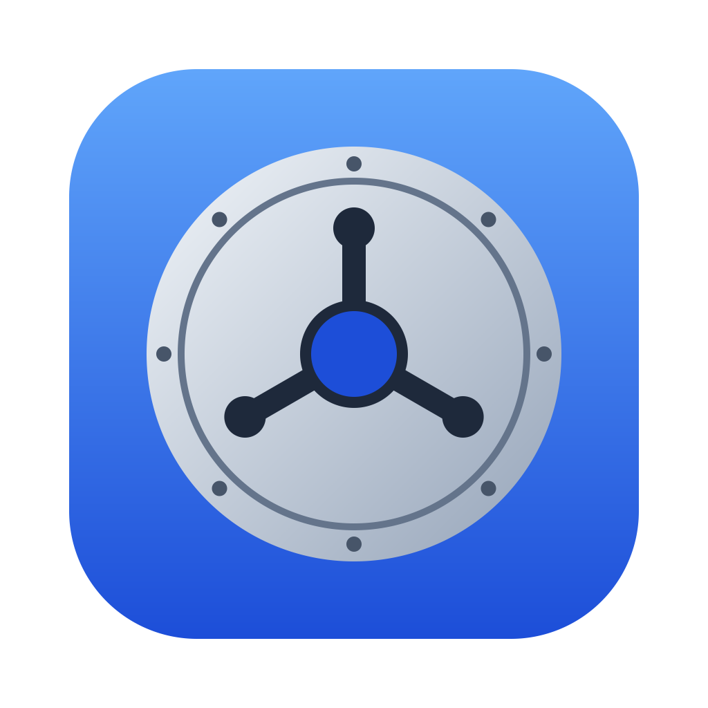
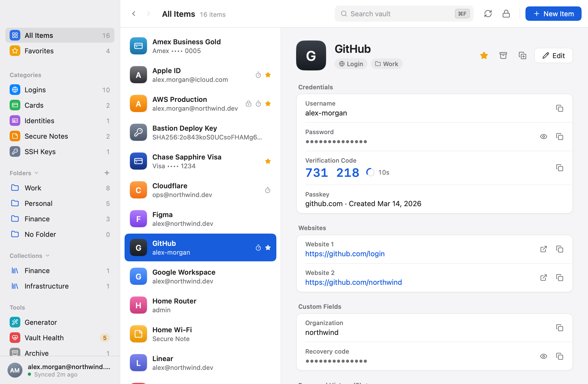

<p align="center">
  
</p>

<h1 align="center">MyVault</h1>

<p align="center">
  A small, fast desktop client for <a href="https://github.com/dani-garcia/vaultwarden">Vaultwarden</a> and Bitwarden-compatible servers, written in Go with <a href="https://github.com/egoist/mygo">MyGo</a>.
</p>

<p align="center">
  <picture>
    <source media="(prefers-color-scheme: dark)" srcset="docs/screenshots/vault-dark.png">
    
  </picture>
</p>

## Install

macOS (Apple silicon) and Linux (x64):

```sh
curl -fsSL https://github.com/oneryx/myvault/releases/latest/download/install.sh | sh
```

Windows (x64), in PowerShell:

```powershell
irm https://github.com/oneryx/myvault/releases/latest/download/install.ps1 | iex
```

Installers are also on the [releases page](https://github.com/oneryx/myvault/releases). MyVault checks for new
versions once a day and installs them after you confirm; **Check for Updates…** in the app menu checks right away,
and Settings → About turns automatic checks off.

## Run from source

You need Go (see [`go.mod`](go.mod) for the version) and [Task](https://taskfile.dev).

```sh
task demo     # a built-in sample vault, with its own settings, no server needed
task          # sign in to your server
task build    # app bundle and installers in dist/
task test     # gofmt, vet and tests
```

The app is one Go binary without CGO. Its interface is drawn natively on the GPU (Metal on macOS, Direct3D 11 on
Windows, OpenGL on Linux), and it runs on macOS, Linux and Windows.

## Features

**Your server**

- Works with Vaultwarden and Bitwarden-compatible servers: PBKDF2 and Argon2id key derivation, AES-256-CBC with
  HMAC-SHA256 item encryption, per-item keys.
- Real-time sync over the server's SignalR (MessagePack) channel, so changes from other devices appear immediately.
- Offline first: the vault opens from an encrypted local cache when the server is unreachable.
- Multiple accounts, on the same or different servers: switch from the account menu at the bottom of the sidebar or
  on the lock screen. Each account keeps its own cache and Touch ID setting.

**Sign-in and security**

- Two-step login with an authenticator app or email, with "remember this device".
- Touch ID unlock on macOS, using a hardware-protected keychain item when the build is entitled to it.
- Locks after inactivity, and when the computer sleeps or the screen locks.
- Master password reprompt for sensitive items: revealing, copying, editing and showing verification codes ask again.
- Copied secrets are marked confidential for clipboard managers and clear themselves from the clipboard.

**Your vault**

- Logins (with live verification codes), cards, identities, secure notes and SSH keys, with an Ed25519 key generator
  and an optional read-only local `ssh-agent` (off by default).
- Attachments: encrypted upload, download and delete. Downloads are written as private files.
- Password history for logins.
- Passkeys: each login shows its passkey (website and creation date), and you can remove it. Fields the app does not
  display are kept intact when you edit an item.
- Organizations and shared collections, honoring read-only and hidden-password permissions.
- Vault Health: reused and weak passwords, expiring cards and unsecured websites, checked on your device.
- Encrypted backup: export a password-protected, Bitwarden-compatible JSON file.
- Reviewed import: import Bitwarden JSON exports and approve each change. Nothing in your vault is overwritten unless
  you choose to.
- Clone items, archive, empty Trash, folders, favorites, password and passphrase generator.
- Website icons from your own server, with a switch to turn them off.

**Desktop**

- Light and dark appearance, resizable three-pane layout.
- Search from the toolbar (⌘F), scoped to the selected category or folder with one click to search everything.
- Back and Forward through views and items, including the mouse side buttons.
- Optional menu bar (tray) icon, launch at login, keyboard shortcuts throughout.

## Keyboard shortcuts

| Keys | Action |
|---|---|
| ⌘F | Search |
| ⌘N | New item |
| ⌘E | Edit the selected item |
| ⌘S | Save the item being edited |
| Esc | Cancel editing |
| ⌘C | Copy the password of the selected item |
| ⇧⌘U | Copy the username |
| ⇧⌘T | Copy the verification code |
| ↑ / ↓ | Move through the list |
| ⌘[ / ⌘] | Back / Forward |
| ⌘R | Sync now |
| ⌘L | Lock |
| ⌘, | Settings |

On Linux and Windows, use Ctrl in place of ⌘.

## Security

- **No plaintext on disk.** The vault is cached only as the server's encrypted data in an atomically written JSON
  snapshot. The master password is never stored.
- **Keys leave memory on lock.** Locking or logging out wipes the user key, organization keys and decrypted items, and
  cancels pending network work and secret actions.
- **A UI-free core.** All cryptography, server communication and vault logic live in
  [`internal/vaultcore`](internal/vaultcore), which imports no GUI or platform code.

More detail in [Architecture](docs/architecture.md) and the [`vaultcore` specification](docs/vaultcore-spec.md).

## License

MyVault is released under the [MIT License](LICENSE). Passphrases use the [EFF large wordlist](https://www.eff.org/dice)
by the Electronic Frontier Foundation, licensed under [CC BY 3.0](https://creativecommons.org/licenses/by/3.0/).
